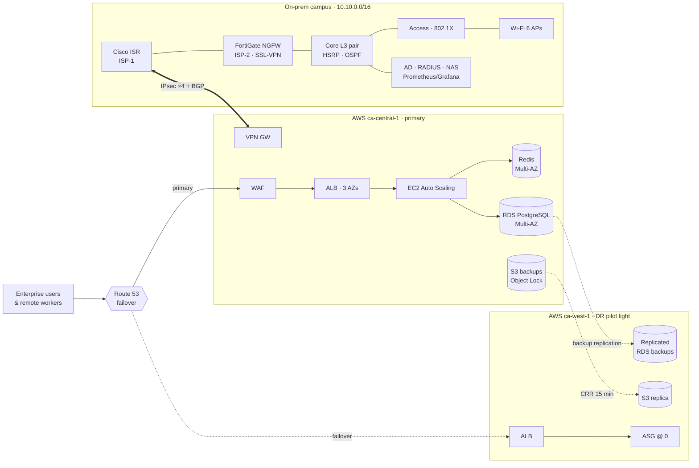

<div align="center">

# ☁️ Enterprise Cloud & Network Modernization

### Stratos Cloud: hybrid AWS + on-premises infrastructure built for SLA compliance, high availability and Canadian data residency

[](https://github.com/SANJU-571/Enterprise-Cloud-Network-Modernization/actions/workflows/ci.yml)


**May 2026 – Aug 2026** · Team project (4 engineers) · Work-Integrated Learning project, Modern Networks & Cloud Computing

[Architecture](docs/architecture.md) · [SLA Analysis](docs/sla-performance-analysis.md) · [Network Design](docs/network-design.md) · [DR Plan](docs/disaster-recovery.md) · [Timeline](docs/implementation-timeline.md)

</div>

---

## 📌 Table of Contents

- [Overview](#-overview)
- [The Problem](#-the-problem)
- [The Solution](#-the-solution)
- [Architecture](#-architecture)
- [Key Features](#-key-features)
- [Tech Stack](#-tech-stack)
- [Repository Structure](#-repository-structure)
- [Getting Started](#-getting-started)
- [SLA: Before vs Target](#-sla-before-vs-target)
- [Design Decisions](#-design-decisions)
- [Security & Compliance](#-security--compliance)
- [Disaster Recovery](#-disaster-recovery)
- [Project Timeline](#-project-timeline)
- [Documentation](#-documentation)
- [Skills Demonstrated](#-skills-demonstrated)
- [License](#-license)

---

## 🔭 Overview

**Stratos Cloud** is a cloud and network services provider serving enterprise
clients (multinational corporations and SaaS providers). This project redesigned
its infrastructure end to end:

- **Modernized the campus network** for a ~300-user enterprise client: a redundant hierarchical design (HSRP, OSPF, LACP), 802.1X, an NGFW, dual ISPs, and a surveyed Wi-Fi 6 deployment.
- **Extended it into AWS** through a secure, multi-AZ landing zone in `ca-central-1` with pilot-light DR in `ca-west-1`. Both regions are in Canada, so data stays in Canada even during failover (PIPEDA).
- **Closed three SLA gaps** found in the performance review: uptime, response time and load-balancer saturation. Every fix is implemented as code and covered by monitoring.

Everything is in this repository: Terraform for AWS, device configurations for
the campus, load-balancer HA configs, SLA-driven monitoring, and Python tooling
for SLA reporting, network validation, capacity forecasting and automated
regional failover.

---

## 🚨 The Problem

The performance review measured the existing platform against its Service Level Agreement:

| Metric | Measured | SLA | Status |
|---|---|---|---|
| Uptime (30 days) | **98.3%** (~734 min down) | ≥ 99.5% (216 min allowed) | ❌ Gap 1.2 pts |
| Server response time | **220 ms** | ≤ 200 ms (p95) | ❌ Gap 20 ms |
| Load balancer throughput | **95% capacity** | ≤ 85% | ❌ Gap 10 pts |
| Bandwidth (monthly) | 10,500 GB | ≤ 15,000 GB | ✅ |
| Inter-DC latency | 95 ms | ≤ 100 ms | ✅ (5 ms headroom) |
| Error rate | 8.2 / day | ≤ 10 / day | ✅ |

**Root causes:** single points of failure (compute, network paths, a single load
balancer), resource contention and slow queries with no caching layer, and
manual scaling that could not react to traffic spikes.
→ Full analysis: [docs/sla-performance-analysis.md](docs/sla-performance-analysis.md)

---

## 💡 The Solution

A three-phase remediation plan, each phase implemented in this repo:

| Phase | Focus | Implementation |
|---|---|---|
| **1. Immediate** (wks 1–2) | Relieve LB saturation, tune servers | Managed ALB with `least_outstanding_requests`; ASG scaling on requests-per-target; HAProxy + keepalived pair on-prem; slow-query logging and indexing |
| **2. High availability** (wks 3–6) | Remove SPOFs, cut latency | 3-AZ Auto Scaling, RDS Multi-AZ, NAT per AZ, Redis cache-aside, HSRP + LACP core pair, dual ISP with SD-WAN |
| **3. Long term** (ongoing) | DR, observability, capacity | Pilot-light DR region, S3 CRR (15-min RTC), automated failover script, SLA-driven alerts, capacity forecasting |

---

## 🏗 Architecture



| Layer | Design |
|---|---|
| **AWS network** | VPC `10.20.0.0/16`, public / app / data tiers across 3 AZs; the data tier has no internet route; flow logs; S3 gateway endpoint |
| **Compute** | ALB (TLS 1.3, WAF) → Auto Scaling group (min 3, one per AZ), scaling on CPU 60% and requests per target |
| **Data** | RDS PostgreSQL 16 Multi-AZ (KMS, forced SSL, PITR replicated to DR) · ElastiCache Redis Multi-AZ |
| **Hybrid link** | 2 customer gateways (one per ISP) × 2 tunnels, IKEv2/AES-256, BGP ↔ OSPF redistribution |
| **Campus** | Collapsed core (2 × Catalyst 9300), access (2960-X), ISR 4331 edge, FortiGate 100F, Meraki MR46/MR36 |
| **Observability** | CloudWatch SLA alarms + dashboard · Prometheus/Grafana with blackbox, SNMP and EC2 discovery |

→ Deep dive with request-path latency budget and failure-mode table: [docs/architecture.md](docs/architecture.md)

---

## ✨ Key Features

**☁️ Cloud (Terraform)**
- 8 reusable modules: `vpc`, `security`, `compute`, `database`, `storage`, `iam`, `vpn`, `monitoring`
- Separate **prod** and **DR** environments with a remote state backend and locking
- Route 53 health-checked failover routing between regions
- SLA alarms that warn before a breach (p95 > 180 ms, LB > 80%, > 10 errors/day)

**🌐 Network**
- HSRP v2 with interface tracking, LACP EtherChannel, Rapid-PVST+, MD5-authenticated OSPF
- 802.1X + MAB, port-security, DHCP snooping, DAI, IP Source Guard, BPDU guard
- Route-based IPsec to AWS with BGP, IP SLA ISP tracking, QoS for voice/video
- FortiGate zoning, IPS, web filtering, SSL-VPN + MFA, SD-WAN failover
- Wi-Fi 6 design from a two-floor predictive survey (−67 dBm target)

**⚖️ Load balancing**
- HAProxy (leastconn, health checks, rate limiting, Prometheus exporter)
- keepalived VRRP VIP: LB failover in about 3 seconds
- NGINX DMZ reverse proxy with micro-caching and TLS hardening

**🐍 Automation & tooling**

| Script | Purpose |
|---|---|
| `scripts/sla_report.py` | SLA gap report (text / Markdown / JSON); exits non-zero on breach |
| `scripts/validate_network.py` | Validates the VLAN plan (overlaps, sizing, AWS overlap) **and** that both core configs match it (SVI IPs, HSRP VIPs, priorities, SSH-only VTY) |
| `scripts/dr_failover.py` | Automated regional failover with per-step timing (measures RTO/RPO); dry run by default |
| `scripts/capacity_forecast.py` | Trend-based forecast of when bandwidth/RPS/storage cross planning thresholds |
| `scripts/network_perf.py` | ping + iPerf3 wrapper graded against latency/jitter/loss/throughput targets |
| `scripts/wifi_survey_report.py` | Grades survey results against the RSSI design target |

**🧪 Quality gates (GitHub Actions)**
- `terraform fmt` / `validate` / `tflint` for both environments
- Checkov IaC security scan
- `ruff` + `pytest` (28 tests) for the tooling and reference app
- Network plan validation and SLA acceptance check on every push
- Weekly scheduled SLA and capacity report

---

## 🧰 Tech Stack

| Category | Technologies |
|---|---|
| Cloud | AWS: VPC, EC2, Auto Scaling, ALB, WAF, RDS PostgreSQL, ElastiCache Redis, S3 (CRR, Object Lock), KMS, IAM, Organizations SCP, Site-to-Site VPN, Route 53, CloudWatch, CloudTrail, GuardDuty, Security Hub, Secrets Manager, SSM |
| IaC & CI | Terraform 1.9, tflint, Checkov, GitHub Actions |
| Networking | Cisco Catalyst 9300 / 2960-X, Cisco ISR 4331, FortiGate 100F, Cisco Meraki MR46 / MR36, Cisco ISE (RADIUS) |
| Protocols | OSPF, BGP, HSRP, LACP, Rapid-PVST+, IPsec IKEv2, 802.1X, VRRP, SNMPv3, QoS (DSCP) |
| Load balancing | AWS ALB, HAProxy 2.x, keepalived, NGINX |
| Observability | Prometheus, Alertmanager, Blackbox & SNMP exporters, Grafana, CloudWatch |
| Application | Python 3.11, Flask, gunicorn, Redis, PostgreSQL, prometheus-client, boto3 |
| Planning tools | Hamina Wireless Planner, Cisco Packet Tracer, Wireshark, iPerf3, NetSpot |

---

## 📁 Repository Structure

```text
.
├── terraform/
│   ├── modules/
│   │   ├── vpc/           # 3-tier multi-AZ VPC, NAT per AZ, NACLs, flow logs
│   │   ├── security/      # KMS CMK, security groups, WAF, GuardDuty, Security Hub
│   │   ├── compute/       # ALB, launch template (IMDSv2), ASG + target tracking
│   │   ├── database/      # RDS PostgreSQL Multi-AZ, DR backup replication, Redis
│   │   ├── storage/       # S3 backup (Object Lock, lifecycle) + CRR to DR
│   │   ├── iam/           # Role-based groups, MFA + region guardrails, CloudTrail
│   │   ├── vpn/           # VGW, dual customer gateways, IPsec + BGP
│   │   └── monitoring/    # SLA alarms, SNS, dashboard, Route 53 health check
│   ├── environments/
│   │   ├── prod/          # ca-central-1 + Route 53 failover records
│   │   └── dr/            # ca-west-1 pilot light
│   └── policies/          # SCP: Canada-only regions, protect audit services
├── network/
│   ├── addressing/        # vlans.yaml: single source of truth for the IP plan
│   ├── cisco/             # core-sw1/2, access template, edge ISR
│   ├── fortigate/         # NGFW policy, SD-WAN, SSL-VPN
│   └── wireless/          # AP plan, RF profile, site-survey results
├── load-balancer/         # haproxy, keepalived, nginx
├── monitoring/            # Prometheus rules, Alertmanager, Grafana dashboard, compose
├── app/                   # Reference workload: Flask API + Redis cache-aside
├── scripts/               # SLA, network validation, DR failover, capacity, perf tools
├── tests/                 # pytest suite
├── data/                  # Baseline metrics, target state, usage samples
├── docs/                  # Architecture, analyses, designs, runbooks
└── .github/workflows/     # CI + weekly SLA report
```

---

## 🚀 Getting Started

### Prerequisites
- Terraform ≥ 1.6 · AWS CLI v2 · Python ≥ 3.11 · Docker (monitoring stack)

### 1. Run the tooling locally

```bash
git clone https://github.com/SANJU-571/Enterprise-Cloud-Network-Modernization.git
cd Enterprise-Cloud-Network-Modernization
python -m venv .venv && source .venv/bin/activate
pip install -r requirements-dev.txt

make test                 # ruff + pytest
make sla                  # SLA gap report from baseline metrics
make validate-network     # VLAN plan + core config consistency
```

Example output:

```text
$ python scripts/sla_report.py data/baseline-metrics.json
Metric                                  Current            SLA  Status
------------------------------------------------------------------------
Uptime (30 days)                        98.3 %   >=    99.5 %   BREACH (gap 1.2 %)
Server response time (p95)               220 ms  <=     200 ms  BREACH (gap 20 ms)
Bandwidth (monthly)                    10500 GB  <=   15000 GB  OK
Inter-region latency                      95 ms  <=     100 ms  OK
Error rate (per day)                     8.2     <=      10     OK
Load balancer capacity                    95 %   <=      85 %   BREACH (gap 10 %)

Downtime in 30 days: 734 min (allowed 216 min)
```

### 2. Deploy AWS

```bash
./scripts/bootstrap_state.sh                     # once: state bucket + lock table

cd terraform/environments/dr                     # DR first (pilot light)
cp terraform.tfvars.example terraform.tfvars
terraform init && terraform apply

cd ../prod
cp terraform.tfvars.example terraform.tfvars     # include DR ALB outputs
terraform init && terraform apply
terraform output vpn_tunnel_addresses            # configure on EDGE-ISR
```

### 3. Configure the campus
Apply the configs in `network/` in the order listed in
[docs/hybrid-deployment-guide.md](docs/hybrid-deployment-guide.md#part-b-on-premises-hardware),
replacing every `<REDACTED>` placeholder with values from the password vault.

### 4. Start monitoring

```bash
docker compose -f monitoring/docker-compose.yml up -d
# Grafana → http://<mon-01>:3000 → "Stratos Cloud - SLA Overview"
```

---

## 📊 SLA: Before vs Target

| Metric | Before | SLA | Design target | Mechanism |
|---|---|---|---|---|
| Uptime | 98.3% | ≥ 99.5% | **99.9%** | 3-AZ ASG, RDS Multi-AZ, HSRP, dual ISP, LB pair, DR region |
| p95 response | 220 ms | ≤ 200 ms | **160 ms** | Redis cache-aside, CPU-based scaling, indexes, least-outstanding-requests |
| LB utilization | 95% | ≤ 85% | **65%** | Managed ALB + scale-out on requests per target; HAProxy tuning |
| Errors | 8.2 / day | ≤ 10 / day | **≤ 5 / day** | Health-checked targets, rolling deploys, graceful cache degradation |
| Inter-region latency | 95 ms | ≤ 100 ms | **≤ 60 ms** | Canadian regions, BGP ECMP over IPsec; Direct Connect upgrade path |
| RTO / RPO | — | < 4 h / < 15 min | **< 4 h / < 15 min** | Pilot light, replicated PITR, S3 RTC, automated failover |

Design targets are the acceptance criteria in [`data/target-state-metrics.json`](data/target-state-metrics.json). CI checks them on every push.

---

## 🧭 Design Decisions

| Decision | Chosen | Over | Reason |
|---|---|---|---|
| Cloud provider | **AWS** | Azure, GCP | Two Canadian regions, enforceable residency guardrails (SCP), strongest hybrid VPN/Direct Connect fit |
| DR model | **Pilot light** | Warm standby, active/active | Meets RTO/RPO at a fraction of the cost |
| Load balancing | **Managed ALB** + least outstanding requests | Bigger self-managed LB | Fixes the saturation problem structurally |
| Latency fix | **Redis cache-aside** | Read replicas only | Bigger p95 win, cheaper; DB remains the source of truth |
| Hybrid routing | **BGP over IPsec** | Static routes | Automatic failover across 4 tunnels / 2 ISPs |
| Perimeter | **FortiGate + ISR** | ISR only | IPS, SSL-VPN + MFA and SD-WAN in one platform |
| PaaS (separate client) | **Elastic Beanstalk** | App Engine, App Service, Heroku | Scalability, compliance and AI integration ([details](docs/paas-evaluation.md)) |

---

## 🔐 Security & Compliance

- **Identity:** MFA enforced for every IAM group, least-privilege roles, AD/RADIUS integration
- **Residency:** SCP + IAM deny any region outside `ca-central-1` / `ca-west-1` (PIPEDA)
- **Network:** tiered security groups, NACLs, private data tier, VLAN segmentation, ACLs, 802.1X
- **Encryption:** KMS customer-managed keys everywhere; TLS 1.2+ enforced (ALB, RDS, Redis, S3)
- **Detection:** CloudTrail (tamper-protected by SCP), Config, GuardDuty, Security Hub, VPC Flow Logs, FortiGate IPS
- **Backups:** S3 Object Lock against ransomware

→ [docs/security-compliance.md](docs/security-compliance.md) · [docs/cloud-provider-evaluation.md](docs/cloud-provider-evaluation.md)

---

## 🛟 Disaster Recovery

```bash
# Dry run: shows the replicated backup, current RPO and every action it would take
python scripts/dr_failover.py --source-db-arn <prod-db-arn>

# Execute: restore DB in ca-west-1, scale ASG, wait for healthy targets, flip DNS
python scripts/dr_failover.py --source-db-arn <prod-db-arn> \
  --target-group-arn <dr-tg> --db-security-group <dr-db-sg> \
  --health-check-id <primary-hc> --execute
```

The script times every step and reports measured **RTO / RPO** against the
targets, so each quarterly drill produces evidence.
→ [docs/disaster-recovery.md](docs/disaster-recovery.md) · [runbook](docs/runbooks/dr-drill.md)

---

## 🗓 Project Timeline

| Period | Milestone |
|---|---|
| **May 2026** | Requirements and technical specification · SLA/performance gap analysis · wired and wireless network blueprint |
| **Jun 2026** | Two-floor Wi-Fi survey · performance measurement toolkit · cloud provider evaluation (PIPEDA) and IAM · PaaS evaluation |
| **Jul 2026** | Wireless topology and security analysis · hybrid cloud + on-prem hardware design · Terraform modules, device configs, LB HA, monitoring |
| **Aug 2026** | DR automation and failover drills · SLA acceptance in CI · runbooks and handover |

→ Week-by-week: [docs/implementation-timeline.md](docs/implementation-timeline.md)

---

## 📚 Documentation

| Document | Contents |
|---|---|
| [Architecture](docs/architecture.md) | Full design, latency budget, failure modes, ADRs |
| [SLA & Performance Analysis](docs/sla-performance-analysis.md) | Gaps, impact, root causes, remediation mapping |
| [Network Design](docs/network-design.md) | Hierarchy, VLAN plan, redundancy, security, QoS, rollout |
| [Wireless Design](docs/wireless-design.md) | Site survey, AP plan, SSIDs, topology comparison |
| [Cloud Provider Evaluation](docs/cloud-provider-evaluation.md) | AWS vs Azure vs GCP for PIPEDA, IAM model |
| [PaaS Evaluation](docs/paas-evaluation.md) | Elastic Beanstalk vs App Engine vs App Service vs Heroku |
| [Hybrid Deployment Guide](docs/hybrid-deployment-guide.md) | Step-by-step AWS + on-prem build |
| [Security & Compliance](docs/security-compliance.md) | Control matrix, PIPEDA / SOC 2 / ISO 27001 mapping |
| [Disaster Recovery](docs/disaster-recovery.md) | Strategy, scenarios, drill programme |
| [Runbooks](docs/runbooks/) | DR drill, SLA alert response, network change |

---

## 🎯 Skills Demonstrated

`Cloud Architecture` · `AWS` · `Terraform / IaC` · `Hybrid Networking` · `BGP / OSPF` ·
`High Availability` · `Disaster Recovery` · `Network Security` · `Zero Trust` ·
`SLA Engineering` · `Observability` · `Wireless Design` · `Compliance (PIPEDA)` ·
`CI/CD` · `Python Automation`

---

## 📄 License

Released under the [MIT License](LICENSE).

> Client names and scenarios are fictional. IP addresses use private and
> documentation ranges (RFC 1918 / RFC 5737). All credentials in configs are placeholders.
