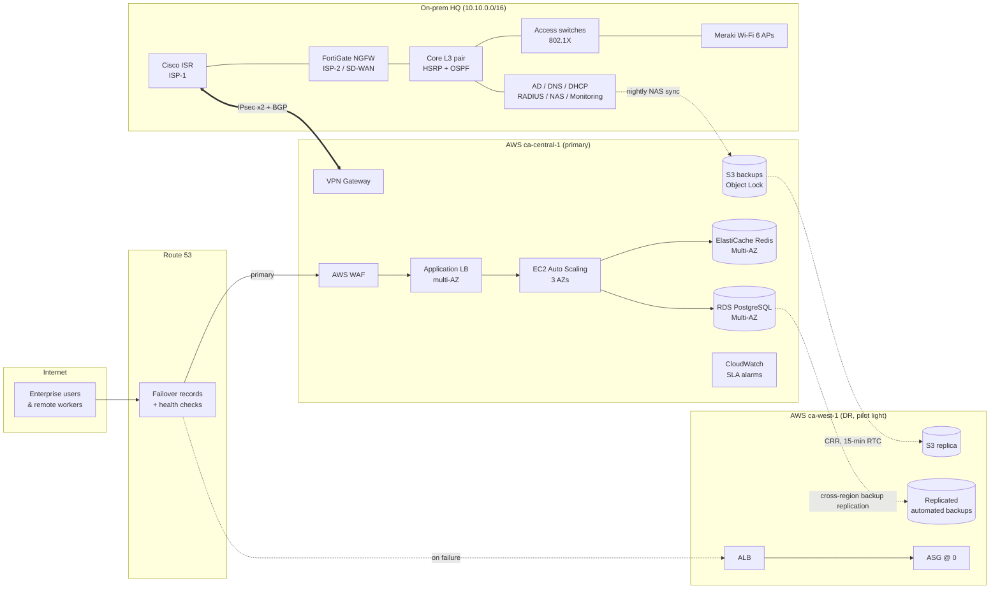
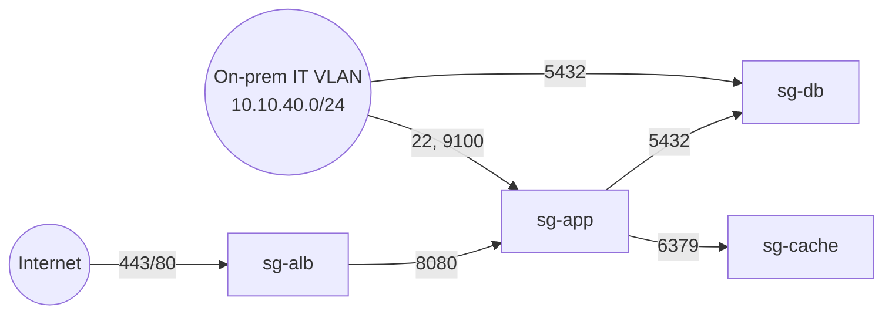
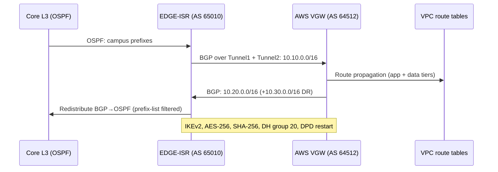

# Architecture

This document describes the target architecture: a hybrid design in which an
enterprise campus network (on-premises) is modernized and extended into AWS
through a secure, highly available landing zone in the Canadian regions.

- [1. Context](#1-context)
- [2. High-level view](#2-high-level-view)
- [3. AWS landing zone](#3-aws-landing-zone)
- [4. On-premises campus](#4-on-premises-campus)
- [5. Hybrid connectivity](#5-hybrid-connectivity)
- [6. Request path and latency budget](#6-request-path-and-latency-budget)
- [7. Availability design](#7-availability-design)
- [8. Key design decisions](#8-key-design-decisions)

---

## 1. Context

| Item | Value |
|---|---|
| Users | ~300 staff across Sales, Finance, Admin, IT and Operations, plus guest Wi-Fi |
| Sites | HQ campus (two floors) + remote workers; design scales to more offices |
| Existing gear | Dual ISPs, Cisco L3 switching, HSRP, STP, EtherChannel, NAT, ACLs, RADIUS |
| Cloud | AWS, `ca-central-1` (primary) and `ca-west-1` (DR) |
| Compliance | PIPEDA (Canadian data residency), SOC 2 / ISO 27001-aligned controls |
| SLA | 99.5% uptime, p95 response ≤ 200 ms, LB ≤ 85% capacity, ≤ 10 errors/day, inter-region latency ≤ 100 ms |
| DR | RTO < 4 h, RPO < 15 min |

## 2. High-level view



## 3. AWS landing zone

### 3.1 Network layout (`terraform/modules/vpc`)

| Tier | CIDR (prod) | Route | Contents |
|---|---|---|---|
| Public | `10.20.0.0/20`, `10.20.16.0/20`, `10.20.32.0/20` | IGW | ALB, NAT gateways |
| App | `10.20.64.0/20`, `10.20.80.0/20`, `10.20.96.0/20` | NAT per AZ + VPN-propagated | EC2 Auto Scaling group |
| Data | `10.20.128.0/20`, `10.20.144.0/20`, `10.20.160.0/20` | **No default route**, VPN-propagated only | RDS, ElastiCache |

- One NAT gateway per AZ, so losing an AZ never removes egress from the surviving AZs.
- S3 gateway endpoint: backups and logs never cross the NAT.
- VPC Flow Logs (ALL traffic) go to a KMS-encrypted CloudWatch log group with 365-day retention.
- The data tier NACL only admits 5432/6379 from app subnets and 5432 from the on-prem range. It is a second, stateless layer behind the security groups.

DR uses the same layout in `10.30.0.0/16`, with a single NAT while idle.

### 3.2 Security groups = firewall zones (`terraform/modules/security`)



The design mirrors the on-prem ASA/FortiGate zoning: each tier accepts traffic only
from the tier in front of it. Admin access goes through SSM Session Manager.
SSH from the IT VLAN over the VPN is a break-glass path.

### 3.3 Compute and load balancing (`terraform/modules/compute`)

- **ALB** with HTTP→HTTPS redirect, TLS 1.3 policy, `drop_invalid_header_fields`, and WAF attached (AWS managed common + SQLi rule sets, plus a per-IP rate limit).
- **Target group** uses `least_outstanding_requests` instead of round robin. This was a direct recommendation of the performance review.
- **Auto Scaling group** spans all three AZs, with minimum 3 (one per AZ), ELB health checks and rolling instance refresh at 90% healthy. Two target-tracking policies:
  - `ASGAverageCPUUtilization` = 60%, which keeps instances below the 70% level at which response times degraded.
  - `ALBRequestCountPerTarget` = 1000/min, which keeps the load-balancing tier well under 85%.
- Launch template enforces IMDSv2, encrypted gp3 volumes (customer-managed KMS key) and detailed monitoring. The instance profile allows only SSM and the CloudWatch agent.

### 3.4 Data (`terraform/modules/database`, `terraform/modules/storage`)

- **RDS PostgreSQL 16, Multi-AZ** (synchronous standby, automatic failover in about 60–120 s). Encrypted with the CMK, with `rds.force_ssl=1`, a password managed by Secrets Manager, Performance Insights, and `pg_stat_statements` with `log_min_duration_statement=200` to surface slow queries.
- **Automated backups replicated to `ca-west-1`** for point-in-time restore in the DR region.
- **ElastiCache Redis 7.1**, Multi-AZ with automatic failover, encrypted in transit and at rest. Used as a cache-aside layer (see `app/cache.py`).
- **S3 backup bucket**: versioning, SSE-KMS, Object Lock (governance, 30 days) against ransomware, lifecycle tiering (IA → Glacier IR → Deep Archive), and a deny on non-TLS access. **Cross-Region Replication** to `ca-west-1` with S3 Replication Time Control (15 minutes), which supports the RPO target.

### 3.5 Identity (`terraform/modules/iam`)

| Group | Access | Guardrails |
|---|---|---|
| `ComplianceAuditor` | Console, `ReadOnlyAccess` + `SecurityAudit` | MFA enforced, Canada regions only |
| `DevOps` | Console + programmatic: EC2/ELB/ASG/S3/CloudWatch/SSM, `PassRole` limited to project roles | Explicit deny on bucket/DB/KMS-key deletion |
| `DataEngineer` | Programmatic only: read client data bucket, decrypt with CMK, RDS IAM auth | Cannot create a console login |

Organization-level guardrails live in `terraform/policies/scp-canada-data-residency.json`.
That SCP denies non-Canadian regions and blocks anyone from disabling CloudTrail, Config or GuardDuty.

### 3.6 Observability (`terraform/modules/monitoring`, `monitoring/`)

Two complementary stacks:

- **CloudWatch** (AWS-native): SLA alarms on ALB p95 latency, requests per target, 5xx per day, healthy hosts, RDS CPU/storage, Redis hit rate and VPN tunnel state, all feeding SNS. An SLA dashboard is defined as code.
- **Prometheus + Grafana** (on-prem, MON-01): scrapes on-prem servers, HAProxy, switches over SNMPv3 and EC2 over the VPN through EC2 service discovery. Blackbox probes measure uptime and inter-region RTT. Recording rules and alerts are tied directly to SLA numbers.

## 4. On-premises campus

Details are in [network-design.md](network-design.md). In summary:

- **Collapsed core/distribution**: a Catalyst 9300 pair with HSRP v2 (SW1 active at priority 110, SW2 standby at 100, interface tracking on the firewall uplink), OSPF area 0 with MD5 authentication, and Rapid-PVST+ with the root pinned on SW1.
- **Access**: Catalyst 2960-X with dual LACP uplinks (one to each core). On every user port: 802.1X with MAB fallback, port-security, BPDU guard, DHCP snooping, DAI, IP Source Guard and storm control.
- **Edge**: a Cisco ISR 4331 on ISP-1 (NAT, IP SLA tracking, IPsec VTIs + BGP to AWS, QoS). A FortiGate 100F NGFW handles zoning, IPS, web filtering, SSL-VPN with MFA, and SD-WAN failover to ISP-2.
- **Wireless**: Meraki MR46 (floor 1) and MR36 (floor 2), with WPA3-Enterprise and 802.1X, a guest SSID isolated on VLAN 60, DFS channels on 5 GHz and a −67 dBm design target.
- **Services**: redundant DHCP/DNS (AD), RADIUS (ISE), syslog, a Prometheus/Grafana stack, a NAS with nightly sync to S3, and UPS on all rack gear.

## 5. Hybrid connectivity



- Two VPN connections (one customer gateway per ISP), each with two tunnels. That gives four paths, and BGP ECMP (`maximum-paths 2`) runs across the healthy ones.
- Prefix lists accept only the AWS VPC ranges inbound and advertise only the campus summary outbound.
- Tunnel logs go to CloudWatch, and the `vpn_down` alarm fires if both tunnels of a connection drop.
- Upgrade path: AWS Direct Connect (1 Gbps) for predictable latency. It would plug into the same VGW/BGP design.

## 6. Request path and latency budget

To hold **p95 ≤ 200 ms** with headroom, each hop has a budget:

| Hop | Budget (p95) | How it is held |
|---|---|---|
| Client → Route 53 → ALB (TLS) | 40 ms | Canada-region endpoint, TLS 1.3, HTTP/2, keep-alive |
| ALB → app instance | 5 ms | Same region; `least_outstanding_requests` avoids hot instances |
| App logic | 40 ms | gunicorn 4 workers × 2 threads; CPU target 60% |
| Cache read (hit) | 5 ms | Redis in the same AZ; 50 ms socket timeout |
| DB query (miss) | 60 ms | Indexed predicates, connection reuse, slow-query logging at 200 ms |
| **Total (miss path)** | **≈150 ms** | Leaves about 50 ms of headroom under the SLA; the alert fires at 180 ms |

## 7. Availability design

| Failure | Impact | Mitigation | Expected recovery |
|---|---|---|---|
| EC2 instance | None | ELB health check + ASG replacement | < 3 min, no user impact |
| Availability Zone | Reduced capacity | ASG across 3 AZs, NAT per AZ, RDS Multi-AZ failover | ~2 min (RDS DNS flip) |
| ALB node | None | Managed, multi-AZ | Transparent |
| Redis primary | Higher latency only | Multi-AZ failover; app falls back to DB on cache errors | < 1 min |
| Core switch | None | HSRP failover (tracked) + dual LACP uplinks | ~3 s |
| On-prem LB node | None | keepalived VRRP VIP | ~3 s |
| ISP-1 | None | IP SLA withdraws default route; FortiGate SD-WAN to ISP-2; VPN over CGW-2 | < 30 s |
| Region (`ca-central-1`) | Outage until failover | Route 53 failover + `dr_failover.py` restore | RTO < 4 h, RPO < 15 min |

Availability arithmetic (why 99.5% becomes achievable):

```
Baseline   : 98.3%  ->  ~734 min downtime / 30 days (single points of failure)
SLA        : 99.5%  ->  216 min allowed / 30 days
Design     : ALB (99.99) x ASG 3-AZ (~99.99) x RDS Multi-AZ (99.95) x Redis (~99.9, soft dependency)
           ~= 99.93% for the hard path  ->  ~30 min / 30 days
```

## 8. Key design decisions

| # | Decision | Alternatives | Why |
|---|---|---|---|
| ADR-01 | **AWS** as the cloud provider | Azure, GCP | Two Canadian regions (data residency through DR), mature IAM/SCP guardrails, PIPEDA-ready compliance artifacts, strongest hybrid VPN/Direct Connect story. See [cloud-provider-evaluation.md](cloud-provider-evaluation.md). |
| ADR-02 | **Terraform** for IaC | CloudFormation | Multi-provider (AWS today, network/SaaS later), module reuse between prod and DR, plan/review workflow in CI. |
| ADR-03 | **Pilot-light DR** in `ca-west-1` | Warm standby, active/active | Meets RTO 4 h / RPO 15 min at a fraction of the cost. Active/active is unjustified at the current SLA. |
| ADR-04 | **Managed ALB** + least-outstanding-requests | Larger self-managed HAProxy in AWS | Removes the 95%-capacity bottleneck structurally. HAProxy + keepalived is kept on-prem where a managed LB is not available. |
| ADR-05 | **Redis cache-aside** | Read replicas only | Cuts p95 on hot read paths far more than replicas do, and is cheaper. The DB stays the source of truth, and cache failures degrade gracefully. |
| ADR-06 | **BGP over IPsec** | Static routes | Automatic failover across four tunnels/two ISPs, and OSPF↔BGP redistribution means no manual route changes when VLANs are added. |
| ADR-07 | **FortiGate NGFW + ISR** | ISR-only, ASA | IPS, web filtering, SSL-VPN + MFA and SD-WAN in one box. The ISR keeps routing, IPsec and QoS duties. |
| ADR-08 | **Elastic Beanstalk** recommended for the separate PaaS workload | App Engine, Azure App Service, Heroku | See [paas-evaluation.md](paas-evaluation.md). |
