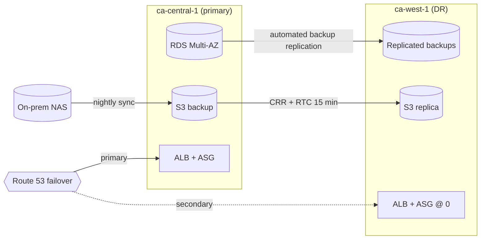

# Disaster Recovery

| Objective | Target | How |
|---|---|---|
| **RTO** | < 4 hours | Pilot-light DR region, automated restore + scale-out (`scripts/dr_failover.py`), Route 53 failover |
| **RPO** | < 15 minutes | RDS automated backups replicated cross-region (PITR); S3 CRR with 15-minute Replication Time Control |

## 1. Strategy



- **Pilot light**: network, security groups, KMS, ALB and an ASG at zero run in DR at all times. Compute and the database are created only during a failover.
- Both regions are in Canada, so failover never breaks data residency.
- The on-prem NAS syncs nightly to S3, so it inherits CRR. File shares can be recovered even if both the campus and the primary region are lost.

## 2. Failure scenarios

| Scenario | Detection | Response | Data loss |
|---|---|---|---|
| Instance / AZ failure | ELB + ASG health checks | Automatic | None |
| RDS primary failure | RDS event | Automatic Multi-AZ failover (~1–2 min) | None (synchronous) |
| Accidental deletion / corruption | User report, Config | PITR restore to a new instance; S3 version restore | Up to the chosen restore point |
| Ransomware on backups | GuardDuty / Macie | Object Lock prevents deletion; restore earlier versions | None within lock window |
| **Region outage** | Route 53 health checks (3 regions), CloudWatch | Run `dr_failover.py --execute` | ≤ 15 min |
| Campus outage | Prometheus/blackbox, ISP alarms | Users work over SSL-VPN / internet to AWS-hosted apps | None for cloud-hosted data |

## 3. Failover procedure (region)

See [runbooks/dr-drill.md](runbooks/dr-drill.md) for the step-by-step version.

1. **Declare** an incident (incident commander + comms lead).
2. **Dry run** to confirm replicated backups and the current RPO:
   ```bash
   python scripts/dr_failover.py --source-db-arn <prod-db-arn>
   ```
3. **Execute** the restore, scale-out, health wait and DNS:
   ```bash
   python scripts/dr_failover.py --source-db-arn <prod-db-arn> \
       --target-group-arn <dr-tg-arn> --db-security-group <dr-db-sg> \
       --health-check-id <primary-hc-id> --execute
   ```
4. **Verify**: synthetic checks, `/healthz`, a smoke test of critical journeys, and confirm writes land in the DR database.
5. **Communicate**: status page and client notifications.
6. **Fail back** once the primary region is healthy. Take a snapshot of the DR DB, restore it in the primary, resync S3 (reverse replication), switch DNS back, and scale DR to zero.

## 4. Drill programme

- **Quarterly** drills, alternating scenarios: regional outage, DB corruption (PITR) and backup restore from S3/Object Lock.
- Every drill records measured RTO/RPO. `dr_failover.py` prints per-step timings.
- Gaps found go into the backlog, and the runbook is updated within a week.

| Drill log | Scenario | RTO measured | RPO measured | Result / actions |
|---|---|---|---|---|
| _template_ | Regional failover | _hh:mm_ | _mm_ | _findings_ |
