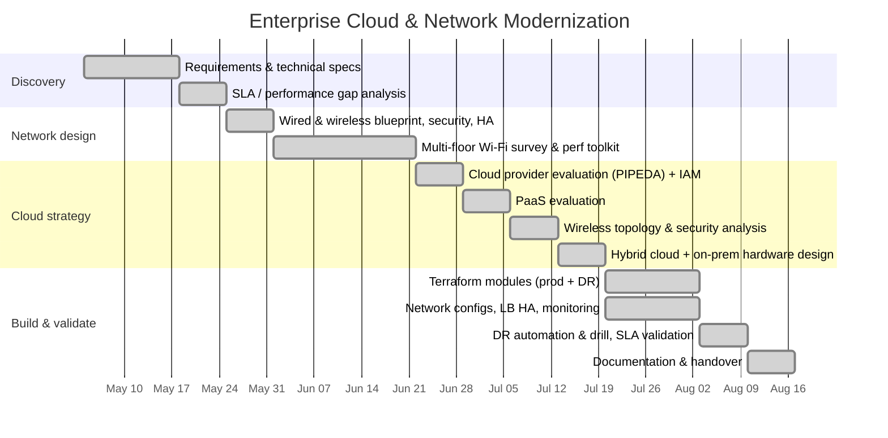

# Implementation Timeline (May – Aug 2026)

The project ran for 15 weeks in agile, one-week iterations. Every iteration
ended with a written deliverable and design review.

## Week by week

| Week | Dates | Focus | Output |
|---|---|---|---|
| 1–2 | May 4 – May 15 | Requirements: objectives, platform and multi-region strategy, redundancy, load balancing, DR targets (RTO < 4 h, RPO < 15 min), security architecture, user needs | Infrastructure requirements and technical specification |
| 3 | May 18 – May 22 | Measured SLA performance; gaps in uptime (98.3%), response time (220 ms) and LB capacity (95%); root causes | [SLA analysis](sla-performance-analysis.md) + three-phase action plan |
| 4 | May 25 – May 29 | Hierarchical wired design (core/distribution/access), VLANs, OSPF, HSRP, EtherChannel; wireless approach; security; redundancy; rollout plan and risks | [Network design](network-design.md) |
| 5–7 | Jun 1 – Jun 19 | Predictive two-floor Wi-Fi survey (Hamina), AP model/placement, wall-material changes; wired/wireless performance measurement method | [Wireless design](wireless-design.md), `scripts/network_perf.py` |
| 8 | Jun 22 – Jun 26 | Azure vs AWS vs GCP against PIPEDA; hybrid alignment with the client's network; IAM users with MFA and region restriction | [Cloud evaluation](cloud-provider-evaluation.md), `modules/iam` |
| 9 | Jun 29 – Jul 3 | PaaS requirements and comparison for a digital-health client | [PaaS evaluation](paas-evaluation.md) |
| 10 | Jul 6 – Jul 10 | Star/mesh/bus/ring/tree: speed, coverage, reliability, security controls | [Wireless design §4](wireless-design.md#4-wireless-topology-comparison) |
| 11 | Jul 13 – Jul 17 | Hybrid cloud hosting (VPC, EC2, ELB/ASG, RDS, S3, IAM, VPN, CloudWatch) + on-prem hardware (ISR, FortiGate, L3 switch, APs, servers, NAS, UPS) | [Architecture](architecture.md), [hybrid deployment guide](hybrid-deployment-guide.md) |
| 12–13 | Jul 20 – Jul 31 | Terraform modules and environments; device configs; HAProxy/keepalived; Prometheus/Grafana + CloudWatch SLA alarms | `terraform/`, `network/`, `load-balancer/`, `monitoring/` |
| 14 | Aug 3 – Aug 7 | DR automation, failover dry runs, acceptance criteria encoded in CI | `scripts/dr_failover.py`, [DR plan](disaster-recovery.md) |
| 15 | Aug 10 – Aug 14 | Runbooks, final documentation, handover | `docs/runbooks/` |
