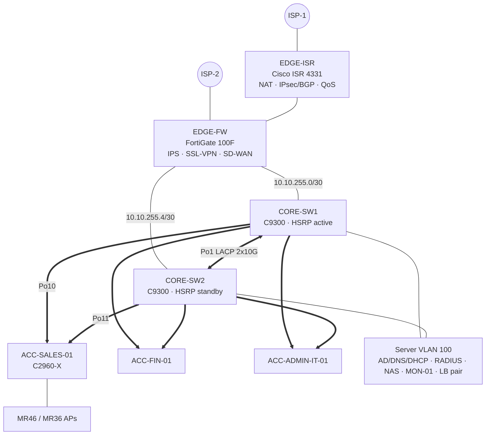

# Network Design (Wired)

The campus design for an enterprise that needs high traffic volumes, secure
data transfer and room to grow into more sites. Configurations are in
[`network/`](../network). The IP plan in
[`network/addressing/vlans.yaml`](../network/addressing/vlans.yaml) is the
source of truth, and CI validates it against the configs with
`scripts/validate_network.py`.

## 1. Topology

`network/cisco/access-sales-01.cfg` is the access-switch template. The other
access switches (Finance, Admin/IT) use the same config with their own VLANs
and Port-channel numbers.

**Hierarchy**

| Layer | Platform | Role |
|---|---|---|
| Edge | Cisco ISR 4331 + FortiGate 100F | Internet, NAT, IPsec to AWS, NGFW, SSL-VPN, SD-WAN |
| Core / distribution (collapsed) | 2 × Catalyst 9300 | Inter-VLAN routing, HSRP gateways, OSPF, STP root |
| Access | Catalyst 2960-X | User ports, PoE+ for APs, 802.1X, L2 security |
| Server farm | VLAN 100 | AD/DNS/DHCP (redundant), RADIUS/ISE, syslog, NAS, monitoring, HAProxy pair |

At a multi-site enterprise the same block is repeated per major office. Each
office becomes an OSPF area interconnected over WAN links (MPLS, IPsec over
internet or dark fibre), and DHCP relays point to centralized servers.

## 2. VLAN & IP plan

Campus summary `10.10.0.0/16` is advertised to AWS as a single prefix.

| VLAN | Name | Subnet | Gateway (HSRP VIP) | Hosts | Notes |
|---|---|---|---|---|---|
| 10 | SALES | 10.10.10.0/24 | .1 | 90 | Wired + corporate SSID |
| 20 | FINANCE | 10.10.20.0/24 | .1 | 45 | ACL: finance servers, core services, internet only |
| 30 | ADMIN | 10.10.30.0/24 | .1 | 40 | HR / administration |
| 40 | IT | 10.10.40.0/24 | .1 | 35 | Only VLAN allowed SSH/SNMP to infrastructure |
| 50 | OPERATIONS | 10.10.50.0/24 | .1 | 70 | Ops / dev, corporate SSID |
| 60 | GUEST | 10.10.60.0/24 | .1 | 120 | Internet only, rate-limited 10 Mbps |
| 99 | MGMT | 10.10.99.0/24 | .1 | 30 | Switch/AP management |
| 100 | SERVERS | 10.10.100.0/24 | .1 | 25 | Static addressing |
| — | SSL-VPN pool | 10.10.200.10–250 | FortiGate | — | Remote workers |
| — | Transit | 10.10.255.0/28 | — | — | Point-to-point /30s, core ↔ FW ↔ ISR |
| 999 | BLACKHOLE | — | — | — | Native VLAN on trunks, parking for unused ports |

Addressing convention: `.1` is the HSRP VIP, `.2` is CORE-SW1 and `.3` is CORE-SW2.

## 3. Redundancy & failover

| Mechanism | Config | Behaviour |
|---|---|---|
| **HSRP v2** | SW1 priority 110 + preempt (30 s delay), SW2 priority 100. SW1 tracks its firewall uplink (decrement 20) | Gateway fails over in ~3 s. If SW1 loses its uplink it hands over the gateway instead of black-holing traffic |
| **EtherChannel (LACP)** | Core↔core Po1, access→each core Po10/Po11, 2 × 10 G each | Bandwidth aggregation and link redundancy; a failed member only removes capacity |
| **Rapid-PVST+** | Root primary SW1, secondary SW2, loop guard, BPDU guard on edge ports | Sub-second convergence and protection against rogue switches |
| **OSPF area 0** | MD5 auth, passive-by-default, SPF throttling 50/200/5000 ms, reference bandwidth 100 G | Fast reroute around failed links/routers |
| **Dual ISP** | ISR IP SLA (5 s probes) tracks ISP-1; FortiGate SD-WAN SLA (latency 100 ms / jitter 30 ms / loss 1%) | Automatic internet failover; the second VPN customer gateway keeps AWS reachable |
| **Power** | Dual PSUs on core/edge, UPS for every rack, graceful shutdown agents | Ride-through and clean shutdown |

## 4. Security controls

| Control | Where | Detail |
|---|---|---|
| VLAN segmentation | All switches | Departments isolated; inter-VLAN traffic routed through the core, where ACLs apply |
| ACLs | Core SVIs, VTY lines, ISR WAN | `ACL-FINANCE-IN`, `ACL-GUEST-IN` (no RFC 1918), `ACL-VTY` (IT VLAN only), WAN anti-spoofing |
| Firewall zoning | FortiGate | WAN / CORE / DMZ / SSL-VPN zones, explicit deny-and-log, IPS blocks high/critical, web filter, AV |
| 802.1X + MAB | Access ports | RADIUS (ISE) authenticates users/devices; MAB fallback for printers/phones |
| L2 hardening | Access | Port-security (max 2 MACs), DHCP snooping, Dynamic ARP Inspection, IP Source Guard, storm control, BPDU guard, unused ports shut in VLAN 999 |
| Secure management | All devices | SSH v2 only (no telnet; CI enforces this), scrypt secrets, AAA via RADIUS with local fallback, SNMPv3 authPriv, syslog + NTP |
| NAT/PAT | ISR | Hides internal topology and conserves public IPv4 |
| Remote access | FortiGate SSL-VPN | TLS 1.2+, RADIUS + FortiToken MFA, 15-minute idle timeout, lockout after 3 failures |
| IDS/IPS | FortiGate (north-south), GuardDuty (AWS) | Choke-point inspection on both sides of the hybrid link |
| AAA | Cisco ISE / RADIUS / TACACS+ | Central authentication, per-command authorization, accounting |

## 5. QoS

WAN egress on the ISR is shaped to 500 Mbps with a child policy:

| Class | DSCP | Treatment |
|---|---|---|
| Voice | EF | Priority queue 15% |
| Video conferencing | AF41 | 30% of remaining |
| Business-critical apps | AF31 | 30% of remaining |
| Default | 0 | Fair queue |

## 6. Rollout timeline (per site)

| Phase | Weeks | Activities |
|---|---|---|
| Planning & design | 1–4 | Requirements and traffic analysis, IP/VLAN plan, routing design, wireless survey, security and HA design, final diagrams, procurement planning |
| Procurement & staging | 5–8 | Order hardware and licences, lab pre-configuration, pre-integration tests |
| Implementation | 9–20 | Rack/cable, L1/L2 checks → core/distribution (OSPF, HSRP, VLANs) → access (EtherChannel, STP, port security) → wireless → firewall/NAT/ACLs → DHCP/DNS/AAA → SIT/UAT → phased cutover |
| Monitoring & handover | Ongoing | Performance monitoring, documentation, knowledge transfer, patching windows |

## 7. Risks & mitigations

| Risk | Mitigation |
|---|---|
| Legacy infrastructure integration | Pre-assessment, phased migration, virtualization, route-policy compatibility |
| Global logistics / time zones | Central PMO, standard hardware bill of materials, local partners |
| WAN reliability | Multiple providers, QoS, WAN optimization, continuous monitoring |
| Inconsistent security policy across sites | Central policy (FortiManager / ISE), segmentation, Zero Trust, regular testing |
| Wireless interference | Site surveys, AP placement, enterprise hardware |
| Budget pressure | Contingency, automation (this repo), cloud for burst rather than buying peak hardware |
| DR complexity | Geo-redundant design, tested DR/BC plans, backups of device configs |
