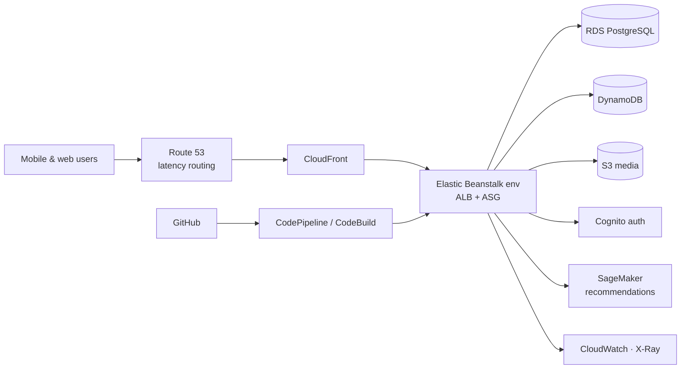

# PaaS Evaluation: Digital Health Workload

A separate engagement within the project. A digital health and fitness company
(fictional client *Fit Fusion*) needed a Platform-as-a-Service to scale globally,
ship faster and add AI features without running servers.

**Recommendation: AWS Elastic Beanstalk**

## 1. Requirements

**Business**
- Scale with demand, especially at peak hours
- Speed to market: CI/CD for frequent releases
- Global reach: deploy close to users
- Security and compliance: HIPAA, GDPR
- Integrations: Zoom, Stripe, Fitbit APIs

**Technical**
- Node.js, Python and Java runtimes
- SQL (PostgreSQL/MySQL) and NoSQL (DynamoDB/MongoDB)
- CI/CD with GitHub Actions / CodePipeline
- RBAC, IAM, encryption at rest and in transit
- Real-time monitoring, alerting, dashboards
- Container/Kubernetes-ready for the future

## 2. Comparison

| Feature | **AWS Elastic Beanstalk** | Google App Engine | Azure App Service | Heroku |
|---|---|---|---|---|
| Languages | Node.js, Python, Java (+ Docker) | Multiple | Multiple | Multiple |
| Scalability | Excellent (EC2 Auto Scaling + ELB) | Good, automatic | Good | Moderate, costly at scale |
| Security | Enterprise-grade (IAM, VPC, KMS) | High | High | Moderate |
| AI integration | SageMaker | Vertex AI, BigQuery | Azure ML | Limited |
| Ease of use | Moderate | Easy | Moderate | Very easy |
| Compliance | HIPAA-eligible, GDPR regions | GDPR | HIPAA, GDPR, ISO | Minimal |
| DevOps | CodePipeline/CodeBuild, GitHub | Cloud Build | Azure DevOps, GitHub Actions | Git push |
| Main drawback | More knobs to learn | Rigid for advanced deployments | Complex portal/pricing | Enterprise compliance, cost at scale |

## 3. Why Elastic Beanstalk
- Global scalability across regions with latency-based Route 53 routing
- Security and compliance built in (IAM, KMS, private networking, HIPAA-eligible services)
- DevOps-ready: CodePipeline/CodeBuild/GitHub integrations
- Cost control: usage-based pricing, Budgets and Cost Explorer
- Future-proof: Docker, Lambda, SageMaker

## 4. Reference architecture

## 5. Implementation phases

| Phase | Scope |
|---|---|
| 1. Assessment & preparation | Map components to managed services (MongoDB → DocumentDB, PostgreSQL → RDS). Multi-account dev/staging/prod, IAM roles. Regions chosen by user analytics (e.g. us-east-1, eu-central-1), Route 53 latency routing |
| 2. Pilot | Deploy a low-risk module (workout tracker) on Node.js + RDS. CI/CD with GitHub → CodePipeline/CodeBuild. CloudWatch logs and dashboards, load testing |
| 3. Full migration | Authentication, nutrition planner and live coaching moved with blue/green or rolling deploys. Cognito, SES, Step Functions replace legacy services. CloudWatch + X-Ray + Config, SNS alerts |
| 4. Optimization & scaling | SageMaker models for coaching/churn. Auto Scaling on CPU/requests. Budgets and Cost Explorer. DR with S3 versioning + CRR and RDS snapshots, with RTO/RPO documented |
